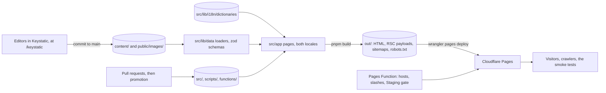

# Architecture

A map of how pitonne.jp is built and served: the static export, where its content comes from, the
Pages Function in front of it, and how a commit reaches each environment. Each part's doc has the
detail; [`AGENTS.md`](AGENTS.md) routes to all of them, and [`CONTEXT.md`](CONTEXT.md) defines the
terms.

## Parts

| Part | What it is | Its doc |
| --- | --- | --- |
| `src/app` | The Next.js App Router: every page under `[locale]`, the English wrappers under `(en)`, the 404 page, `robots.txt`, the sitemap routes and the Keystatic routes | [`docs/i18n.md`](docs/i18n.md) |
| `src/components` | The site's components by area, `shared/` for several areas, `ui/` for stock shadcn | [`code.md`](docs/agents/code.md) |
| `src/lib` | Data loaders, dictionaries, metadata, structured data, sitemaps, the environment model and the host rules; no UI | [`code.md`](docs/agents/code.md) |
| `content/` | Markdown and JSON: services, legal pages, blog posts and categories, English with `ja/` beside it | [`content.md`](docs/agents/content.md), [`blog.md`](docs/agents/blog.md) |
| `public/` | Images, icons, and Cloudflare Pages' `_headers`, `_redirects` and `_routes.json` | [`hosts.md`](docs/agents/hosts.md) |
| `keystatic.config.ts` | The CMS: the blog's two collections and the categories | [`blog.md`](docs/agents/blog.md) |
| `functions/_middleware.ts` | The Cloudflare Pages Function, which runs `src/lib/canonical-host.ts` on each request | [`hosts.md`](docs/agents/hosts.md) |
| `scripts/` | The post-build headers step, the audits, and CI's deploy and smoke-test scripts | [`seo.md`](docs/agents/seo.md), [`ci.md`](docs/agents/ci.md) |
| `.github/workflows/` | CI, deploys, promotion and the Staging sync | [`ci.md`](docs/agents/ci.md) |

Why the code sits in `src/` and the content at the root is
[ADR 0004](docs/adr/0004-repository-layout.md).

## How it fits together

## The static export

- The site is a Next.js static export (`output: 'export'` in `next.config.mjs`), served by
  Cloudflare Pages with nothing rendered per request ([ADR 0003](docs/adr/0003-static-export-on-cloudflare-pages.md)).
  `trailingSlash: true` writes every page as `<path>/index.html`, and `images.unoptimized` serves
  images as they are.
- **Routes.** Each page is implemented once, in `src/app/[locale]/`, whose layout renders
  `<html lang>`, the header and footer, the site's JSON-LD and, on Production, Google Tag Manager.
  Its `generateStaticParams` builds only `ja`. English pages are thin wrappers in
  `src/app/(en)/` that render the same page with the `en` locale at the bare URL, because a static
  export can't rewrite `/x/` to `/en/x/`. `/en/...` redirects to the bare path through
  `public/_redirects`.
- **The 404 page** is `src/app/global-not-found.tsx`, a full English document that Pages serves
  with status 404 for any URL that has no file.

## Content and text

- **Content files** are read when the site builds, by the loaders in `src/lib/data/`:
  `blog-posts.ts` and `blog-categories.ts` for the blog, `services.ts` for services and
  `pages.ts` for the legal pages. Each checks its files against a zod schema, so a bad file fails
  the build rather than a page.
- **Data in code:** the areas, one file per ward in `src/lib/data/wards/`; the videos in
  `src/lib/data/videos.ts`; the business details in `src/lib/data/site.ts`. Each keeps its
  English and Japanese values side by side.
- **Interface text** is in `src/lib/i18n/dictionaries/en.json` and `ja.json`, loaded with
  `getDictionary(locale)`. A client component gets only the strings it needs, from its server
  parent.
- **A blog post may exist in one language only;** services and legal pages always exist in both.

## The CMS

Keystatic runs as a single-page app at `/keystatic`. The export has one `/keystatic/` page, and
`public/_redirects` serves it for every `/keystatic/*` path. Editors sign in through Keystatic
Cloud, and each save is a commit to `main` that deploys Production without a promotion. The local
CMS modes (`pnpm cms`, `pnpm cms:cloud`) turn the export off so Keystatic's API route can run
([`blog.md`](docs/agents/blog.md#keystatic)).

## The Pages Function

`functions/_middleware.ts` hands each request to `handleRequest` in `src/lib/canonical-host.ts`,
which imports nothing, so Wrangler can bundle it:

- **Host redirects:** a non-canonical host, such as `pitonne-jp.pages.dev` or a deployment URL,
  gets one 308 to the same path on its environment's canonical host, with any `_redirects` rule
  folded into the same hop.
- **Slashed files:** `/robots.txt/` gets one 308 to `/robots.txt`.
- **The Staging gate:** on Staging hosts, HTTP Basic auth with the shared password, except for
  smoke-test requests and `/robots.txt`.

`public/_routes.json` keeps static files off the Function on Production and previews; a Staging
build sends every path through it ([`hosts.md`](docs/agents/hosts.md),
[`environments.md`](docs/agents/environments.md)).

## Environments

`DEPLOY_ENV` (`production`, `staging` or `preview`) is read only by
`src/lib/deploy-environment.mts`, and everything else asks its helpers. It sets the origin a
build writes into canonicals, hreflang, JSON-LD and sitemaps; whether `robots.txt` and the pages
allow indexing; whether Google Tag Manager loads; and whether the gate is on. After `next build`,
`scripts/environment-headers.mjs` writes the environment's `X-Robots-Tag` lines into
`out/_headers` and its `out/_routes.json` ([`environments.md`](docs/agents/environments.md)).

## Sitemaps

`/sitemap-index.xml`, the only sitemap `robots.txt` lists, names one child per content group
(`/sitemap-pages.xml`, `-services`, `-areas`, `-blog`, `-categories`, `-videos`), each a static
route handler in `src/app/sitemap-<group>.xml/route.ts` that `src/lib/sitemaps.ts` fills
([`seo.md`](docs/agents/seo.md#sitemaps)).

## From commit to environment

1. A pull request into `staging` runs CI's `verify` (SERP's shared checks) and `test` (lint,
   types, tests, the production build and its audits), then `e2e` (the browser journeys) and
   `lighthouse` on that build once it's ready for review. A same-repository pull request also
   gets a preview at `pr-<n>.pitonne-jp.pages.dev`, and the `Pull request` and `Code review`
   workflows check its title, issue link and code.
2. A push to `staging` deploys Staging; a push to `main`, a promotion or a CMS save, deploys
   Production. `deploy.yml` builds the branch tip with the environment's `DEPLOY_ENV`, checks the
   output, uploads `out/` with `wrangler pages deploy` and smoke-tests the result.
3. Code waits for `verify`, `test`, `e2e` and `lighthouse` before it deploys; CMS content and
   commits that already passed them deploy at once
   ([`gitflow.md`](docs/gitflow.md#what-ci-deploys), [`ci.md`](docs/agents/ci.md)).

## Layers

`src/app` imports `src/components` and `src/lib`; `src/components` imports `src/lib`; `src/lib`
imports neither. Biome's `noRestrictedImports` in `biome.json` holds this, and the dependency
check holds the import graph to the entry points in `verify.json`
([`code.md`](docs/agents/code.md#layers)).
